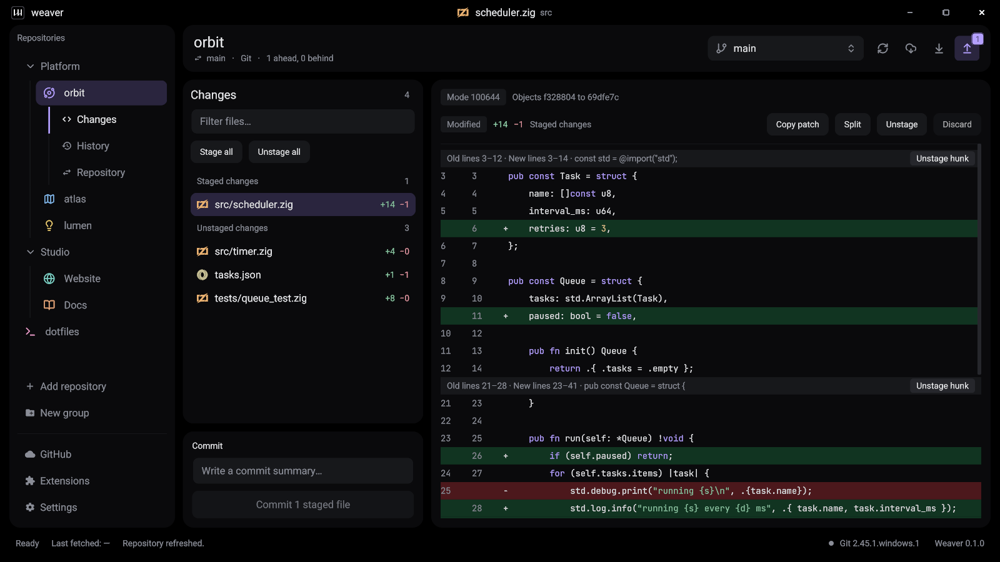
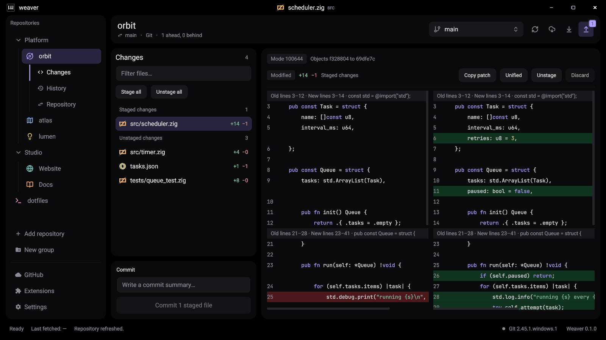

# Weaver

Weaver is a fast, native Git desktop app for Windows, macOS and Linux. It is written in Zig with [KnotsUI](https://github.com/knots-ui/knots) and [libgit2](https://libgit2.org), so there is no webview or Electron runtime: one small executable that opens instantly and stays out of your way.



[](https://github.com/KeoneSomers/Weaver/actions/workflows/ci.yml)
[](LICENSE)


> **Development preview.** Weaver is usable day to day but still young. Windows is the most tested platform; macOS and Linux build from the same source and have had less testing. Please [open an issue](https://github.com/KeoneSomers/Weaver/issues) if something does not work on your machine.

## Download

These links always point at the newest build; the [latest release](https://github.com/KeoneSomers/Weaver/releases/latest) is rebuilt automatically for every change on `main`.

| Platform | Download | How to run |
| --- | --- | --- |
| Windows (x64) | [`Weaver-windows-x86_64.zip`](https://github.com/KeoneSomers/Weaver/releases/latest/download/Weaver-windows-x86_64.zip) | Extract the folder and run `weaver.exe`. |
| macOS (Apple Silicon) | [`Weaver-macos-aarch64.dmg`](https://github.com/KeoneSomers/Weaver/releases/latest/download/Weaver-macos-aarch64.dmg) | Open the disk image and drag Weaver to Applications. |
| Linux (x64, Wayland) | [`Weaver-linux-x86_64.tar.gz`](https://github.com/KeoneSomers/Weaver/releases/latest/download/Weaver-linux-x86_64.tar.gz) | Extract and run `bin/weaver`. |

The downloads are not code-signed yet, so your system will warn you the first time:

- **Windows:** on the SmartScreen prompt choose **More info**, then **Run anyway**.
- **macOS:** after the first blocked launch, open **System Settings → Privacy & Security** and choose **Open Anyway**, or run `xattr -dr com.apple.quarantine /Applications/Weaver.app`.

Weaver uses the Git you already have installed, so install [Git](https://git-scm.com/downloads) first (and Git LFS for repositories that use it). Linux also needs a Wayland session, a Vulkan 1.3 driver and `xdg-desktop-portal`; the build is made on Ubuntu 24.04, so older distributions may need to build from source. `SHA256SUMS.txt` in the release lists the checksums.

## Features

**Repositories**

- Add, initialize or clone repositories, or drag a folder into the window. Linked worktrees open directly.
- Keep many repositories in the sidebar, reorder them and sort them into groups.
- Sign in to GitHub in one click through Git Credential Manager and clone your public or private repositories over HTTPS or SSH.

**Changes and diffs**

- Staged and unstaged changes in separate lists, with file-type icons and added/removed line counts.
- Syntax-highlighted diffs in unified or side-by-side view.
- Stage or unstage whole files, single hunks or everything at once, then commit.
- Right-click a file to open it in your editor, reveal its folder, copy its path, add it to `.gitignore`, or discard its changes (with confirmation).



**Branches and history**

- Create, switch, publish and delete branches from a native branch picker.
- Fetch, pull and push from the toolbar, with badges showing how many commits you are ahead or behind.
- Merge, rebase, cherry-pick, revert, stash and tag.
- Browse commit history and each commit's diff.
- Resolve conflicts in the app: inspect the markers, keep either side, then continue or abort.

**Guidance when things go wrong**

- A repository without a remote gets a banner and a dialog that adds `origin` and pushes straight away.
- A failed push, pull, fetch or clone opens a dialog with Git's output and the next step to take.

**Git LFS**

- Set up LFS, track file types, and view transfers, status and locks.

**Look and feel**

- Eleven themes, eight dark and three light, with twelve accent colors.
- Resizable panels and a custom title bar.
- Optional background fetch every five minutes, off by default.

**Extensions**

- Add commands and settings with small executables that speak JSON over standard input and output, written in any language. See the [extension API](docs/extensions.md).

**Safe by design**

- Git commands are passed as argument arrays; repository content is never interpreted by a shell.
- Credentials stay in the operating system's credential store, never in settings or remote URLs.
- Your Git hooks, commit signing and LFS filters keep working because Weaver uses your Git configuration.
- Weaver never force-pushes, hard-resets or deletes untracked files on its own, and destructive actions ask first.

## Build from source

The only build tool you need is **Zig 0.17.0**. Everything else (KnotsUI, libgit2, the native file dialog) is pinned in `build.zig.zon`; `zig build` downloads and compiles it for you. The first build takes a couple of minutes.

```sh
git clone https://github.com/KeoneSomers/Weaver.git
cd Weaver
zig build run
```

To build an optimized executable instead, run `zig build -Doptimize=ReleaseSafe`. The result is `zig-out/bin/weaver` (`weaver.exe` on Windows). Pass a folder to open it on launch: `zig-out/bin/weaver /path/to/repository`.

Weaver needs the exact Zig version above, because KnotsUI tracks Zig closely. Get it from [ziglang.org/download](https://ziglang.org/download/) or with a version manager such as [zvm](https://github.com/tristanisham/zvm) (`zvm install 0.17.0`).

At run time Weaver uses the **Git** you already have installed, plus **curl**, and **Git LFS** for repositories that use it.

### Windows

1. Install [Git for Windows](https://git-scm.com/download/win). It includes Git LFS, curl and Git Credential Manager.
2. Install Zig 0.17.0.
3. Run `zig build run` in the cloned folder.

No Visual Studio or other compiler is needed.

### macOS

Apple Silicon only; Intel Macs are not supported.

1. Install the Xcode Command Line Tools, which provide Git and the system frameworks:

   ```sh
   xcode-select --install
   ```

2. Install Zig 0.17.0.
3. Run `zig build run` in the cloned folder.

Optional: `brew install git-lfs` for LFS repositories, and `brew install --cask git-credential-manager` for one-click GitHub sign-in.

### Linux

Weaver needs a **Wayland** session (KnotsUI has no X11 backend yet), a **Vulkan 1.3** driver, and a desktop portal with a file chooser (`xdg-desktop-portal`, which GNOME and KDE install by default).

1. Install the build packages for your distribution:

   ```sh
   # Debian, Ubuntu
   sudo apt install git git-lfs curl pkg-config libwayland-dev wayland-protocols libxkbcommon-dev libdbus-1-dev libvulkan1
   ```

   ```sh
   # Fedora
   sudo dnf install git git-lfs curl pkgconf-pkg-config wayland-devel wayland-protocols-devel libxkbcommon-devel dbus-devel vulkan-loader
   ```

   ```sh
   # Arch
   sudo pacman -S --needed git git-lfs curl pkgconf wayland wayland-protocols libxkbcommon dbus vulkan-icd-loader
   ```

2. Install Zig 0.17.0.
3. Run `zig build run` in the cloned folder.

`zig build` also installs a desktop entry and icons under `zig-out/share`. Optional: install [Git Credential Manager](https://github.com/git-ecosystem/git-credential-manager/blob/main/docs/install.md) and `secret-tool` (`libsecret-tools` on Debian and Ubuntu) for one-click GitHub sign-in.

### Troubleshooting

- **Zig reports a version mismatch or unfamiliar compile errors.** Check `zig version` prints `0.17.0`.
- **A dependency fails to download** (for example `invalid HTTP response: HttpConnectionClosing`). The first build downloads several large packages from GitHub and gitlab.freedesktop.org, and a transfer sometimes drops. Run `zig build` again; it continues from what it already has.
- **Linux: `wayland-scanner` or a `.pc` file is not found.** One of the packages above is missing.
- **Linux: the window does not open.** Check you are in a Wayland session (`echo $XDG_SESSION_TYPE`) and that `vulkaninfo` reports Vulkan 1.3.

## Development

```sh
zig build test -Dheadless=true   # backend tests: Git, diffs, security, persistence
zig build test-ui                # pointer routing tests
zig build check -Dheadless=true  # build the headless inspector
zig-out/bin/weaver-check /absolute/path/to/repository
```

`-Dheadless=true` skips the UI, so backend tests run without a display or GPU. Update a pinned dependency with `zig fetch --save=<name> <url>`.

Settings are stored in `%APPDATA%\Weaver` on Windows and `~/.config/Weaver` on macOS and Linux. Set `WEAVER_CONFIG_HOME` to use a different folder, which is handy for trying things without touching your real workspace.

More documentation:

- [Extension API](docs/extensions.md)
- [Repository performance](docs/performance.md)
- [Releases, signing and updates](docs/releases.md)
- [Application icon](docs/icons.md)

## Current limitations

- Downloads are not code-signed, and there is no installer or automatic update yet.
- Linux needs Wayland; there is no X11 backend.
- macOS needs Apple Silicon; KnotsUI's GPU and scripting dependencies have no Intel Mac builds.
- No complex text shaping or IME composition yet.
- History shows the latest 300 commits.
- Text previews are limited to 2 MiB and 25,000 lines; there are no image diffs.
- Not yet available: staging selected lines, pull request creation and review, submodule and worktree management, and an extension marketplace.
- Git is the only provider, although the UI model is provider-neutral.

## License

Weaver is released under the [MIT License](LICENSE).

## Third-party software

KnotsUI and the Devicon icon font are MIT licensed, Lucide icons are ISC, JetBrains Mono uses the SIL Open Font License, Native File Dialog Extended uses the zlib license, and libgit2 is GPLv2 with a linking exception. Details are in [THIRD_PARTY_NOTICES.md](THIRD_PARTY_NOTICES.md), and `zig build` copies the license texts into `zig-out/licenses`.
